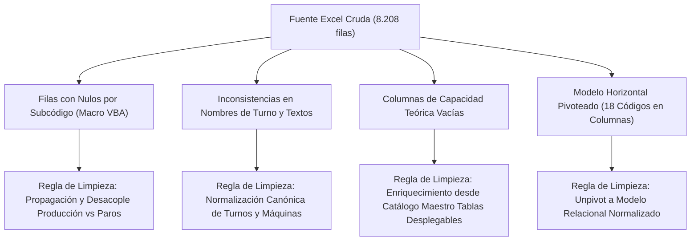

# Diagnóstico de la Fuente de Datos y Calidad de Datos
**Empresa Fabricante de Vinilos y Témperas**  
**Proyecto de Inteligencia de Negocios End-to-End**

---

## 1. Identificación de Usuarios y Preguntas de Negocio

| Rol / Usuario | Nivel | Herramienta Principal | Preguntas de Negocio Clave |
| :--- | :--- | :--- | :--- |
| **Gerencia General y Dirección de Operaciones** | Estratégico | Power BI | • ¿Cuál es el OEE global de la planta y cómo ha evolucionado mes a mes entre 2022 y 2025? • ¿Qué líneas de envasado (Vinilos_1 a 4) presentan la mayor rentabilidad operativa y cuáles son cuellos de botella? • ¿Cómo se compara el rendimiento productivo de 2024 frente a 2025 para justificar inversiones de capital? |
| **Coordinador / Jefe de Mantenimiento** | Táctico | Power BI / Grafana | • ¿Cuáles son las causas raíz del 80% de los tiempos de paro (análisis de Pareto)? • ¿Cuál es el MTBF (Tiempo Medio Entre Fallas) y MTTR (Tiempo Medio de Reparación) por componente electromecánico? • ¿Qué subsistemas (dosificación, bandas, sellado, video jet) requieren mantenimiento preventivo prioritario? |
| **Supervisores de Producción / Turno** | Operativo | Grafana (Near Real-Time) | • ¿Qué máquina se encuentra detenida en este momento y cuál es el motivo de paro activo? • ¿Cuál es la producción acumulada hora a hora frente a la meta del turno? • ¿Se ha generado una alerta por caída de disponibilidad o exceso de tiempo muerto (>45 min)? |
| **Líder de Aseguramiento de Calidad** | Táctico / Operativo | Power BI | • ¿Qué impacto tienen las esperas de aval microbiológico (Código 13) y materia prima defectuosa (Código 12) en la eficiencia global? • ¿Cuál es la tasa de merma y reproceso asociada a cada referencia y presentación? |

---

## 2. Diagnóstico Técnico de la Fuente de Datos

La fuente analizada corresponde al archivo de hoja de cálculo con macros:  
`SEGUIMIENTO TEMPERAS Y VINILOS Actividad.xlsm` (con procedimiento base `P-MTO-22`).

### 2.1 Estructura del Libro Excel
El libro contiene 21 hojas, de las cuales se destacan:
1. **`Base De Datos`**: Tabla transaccional primaria histórica (8.208 filas registradas entre 2022 y marzo de 2025, 58 columnas).
2. **`Base de datos de Sub codigos`**: Registros específicos de subcódigos de paros (1.252 filas entre octubre de 2023 y mayo de 2024, 19 columnas).
3. **`TABLA CODIGOS`**: Catálogo estructurado de áreas de impacto, 18 códigos de paro y jerarquía de subcódigos y componentes.
4. **`Tablas Desplegables`**: Parámetros maestros de máquinas, velocidades nominales teóricas (unidades/minuto), factores de empaque (unidades/display, display/paca) y agentes de intervención.
5. **`Registro`**: Interfaz de captura mediante formulario de usuario y macros VBA (`Ingreso total`, `Ingreso Sub Codigo`, `Limpiar`).
6. **`Tiempos`** y hojas de tablas dinámicas (`TD_prodMaq`, `TD_prodAño`, `TD_prodCodigo`, etc.).

---

## 3. Problemas de Calidad de Datos (Data Quality) Detectados

Durante la auditoría técnica profunda sobre los 8.208 registros de la hoja `Base De Datos`, se identificaron los siguientes problemas críticos de calidad:

### 3.1 Hallazgos Específicos
1. **Desbalance de granularidad por uso del botón "Ingreso subcódigo":**
   * Cuando en un mismo turno ocurrían múltiples paros con diferente subcódigo, la macro VBA guardaba una nueva fila conservando la fecha y máquina, pero dejando en blanco `Operario` (3.721 filas nulas), `Referencia` (3.874 filas nulas), `Turno` (3.912 filas nulas), `Horas trabajadas` (3.049 filas nulas) y `Pacas producidas` (3.051 filas nulas).
   * **Riesgo en Excel:** Si un analista realiza una suma directa o promedio sin filtrar, se distorsionan los promedios de productividad.
2. **Estructura Desnormalizada y Horizontal (Pivoteada):**
   * Existen 18 pares de columnas para códigos de paro (`Codigo de paro 1`, `Codigo 1 en horas`, ..., `Codigo de paro 18`, `Codigo 18 en horas`).
   * Esto viola la 1FN (Primera Forma Normal) y hace inviable consultar series temporales eficientes en SQL sin un proceso de `UNPIVOT` / normalización.
3. **Inconsistencia en Dominios de Atributos (`Turno`):**
   * Se registran valores dispares para el mismo concepto: `'6am-2pm (Turno 1)'`, `'6am-4:30pm'`, `'2pm-10pm (Turno 2)'`, `'10pm-6am (Turno 3)'`, `'6am-6pm'`, `'6pm-6am'` y `'No aplica'`.
4. **Columnas de Maestro Incompletas en la Transaccional:**
   * Las columnas `Unidades producidas cada minuto` y `Display por paca` están al 100% vacías en `Base De Datos`, obligando al ETL a cruzar con la hoja de maestros (`Tablas Desplegables`) para calcular la capacidad nominal.
5. **Filas con Registro Cero:**
   * 401 filas con `Horas trabajadas = 0` y 427 filas con `Pacas producidas = 0`, correspondientes a turnos suspendidos o paros totales.

---

## 4. Limitaciones del Esquema Actual de Reporte

1. **Latencia Excesiva (Procesamiento Mensual Batch):**
   * Los datos pasan de papel a transcripción manual en Excel, consolidándose únicamente para el comité mensual. Los supervisores no se enteran a tiempo de caídas de disponibilidad.
2. **Vulnerabilidad y Falta de Concurrencia:**
   * Un archivo `.xlsm` monousuario alojado en carpetas compartidas sufre bloqueos de edición, riesgo de corrupción de macros VBA y pérdida accidental de fórmulas.
3. **Ausencia del Indicador Estándar OEE:**
   * El Excel actual únicamente calcula `% Productividad` empírica basada en pacas reales vs meta estimada, ignorando el desglose estandarizado de **Disponibilidad, Rendimiento y Calidad**.
4. **Falta de Trazabilidad y Linaje:**
   * No existe auditoría de quién modificó una celda, fecha de carga ni versionado de datos históricos.
