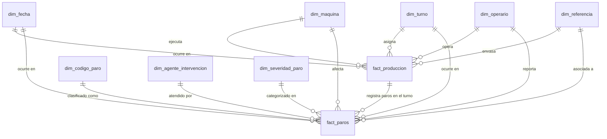

# Modelo Dimensional (Metodología Kimball) y Matriz de Bus
**Proyecto de Inteligencia de Negocios End-to-End**

---

## 1. Justificación del Modelo en Estrella (Star Schema)

Para la solución analítica se seleccionó un **Modelo en Estrella (Star Schema)** con dimensiones conformadas frente a un modelo en Copo de Nieve (Snowflake) por las siguientes razones:

1. **Rendimiento Analítico Superior:**
   * Al desnormalizar controladamente las jerarquías dentro de las dimensiones (ej. jerarquía de paros en una sola dimensión `dim_codigo_paro`), se minimiza el número de `JOINs` requeridos en las consultas analíticas en PostgreSQL y Grafana.
2. **Compatibilidad Nativa con el Motor VertiPaq de Power BI:**
   * El motor columnar de Power BI comprime y filtra con máxima eficiencia esquemas en estrella puros (relaciones 1 a Varios simples con dirección de filtro única), evitando la ambigüedad y el costo de memoria de relaciones en cascada.
3. **Comprensión Intuitiva para los Usuarios del Negocio:**
   * Facilita a supervisores y analistas navegar los campos y medidas sin necesidad de comprender modelos entidad-relación complejos.

---

## 2. Declaración Explícita del Grano (Grain Declaration)

Se definen dos tablas de hechos que modelan los dos procesos centrales del negocio:

### Tabla de Hechos 1: `fact_produccion`
* **Declaración del Grano:** Un registro por cada **turno de trabajo realizado en una máquina de envasado específica, en una fecha determinada y procesando una referencia de producto**.
* **Tipo:** Hechos periódicos acumulados (Periodic Snapshot / Transactional Shift).
* **Métricas Principales:** Horas trabajadas, Horas programadas, Pacas producidas, Unidades reales producidas, Capacidad teórica ideal, Tiempo total de paro del turno, Disponibilidad, Rendimiento, Calidad y OEE.

### Tabla de Hechos 2: `fact_paros`
* **Declaración del Grano:** Un registro por cada **evento discreto de interrupción o paro reportado en una máquina, fecha y turno, clasificado a nivel de código de paro, subcódigo y componente**.
* **Tipo:** Hechos transaccionales atómicos (Atomic Transactional).
* **Métricas Principales:** Duración del paro en horas, duración en minutos, costo estimado de paro.

---

## 3. Matriz de Bus de Kimball (Bus Matrix)

La arquitectura matricial vincula los procesos de negocio mediante **Dimensiones Conformadas**:

| Proceso de Negocio | `dim_fecha` | `dim_maquina` | `dim_turno` | `dim_operario` | `dim_referencia` | `dim_codigo_paro` | `dim_agente_intervencion` | `dim_severidad_paro` |
| :--- | :---: | :---: | :---: | :---: | :---: | :---: | :---: | :---: |
| **Producción de Envasado** (`fact_produccion`) | **X** | **X** | **X** | **X** | **X** | - | - | - |
| **Eventos de Paro y Mantenimiento** (`fact_paros`) | **X** | **X** | **X** | **X** | **X** | **X** | **X** | **X** |

---

## 4. Modelado de Jerarquías y Dimensiones Propias

### 4.1 Jerarquía de Paros (`dim_codigo_paro`)
Se modela dentro de la dimensión conformada en cuatro niveles jerárquicos desnormalizados:
* **Nivel 1 (Área de Impacto):** Mantenimiento, Producción, Calidad, Almacén de materias primas, Paros programados.
* **Nivel 2 (Código de Paro):** [01] al [18] (ej. `[01] Falla del sistema electromecánico y/o de control`).
* **Nivel 3 (Subcódigo):** Agrupación funcional (ej. `1.1 Falla mecánica`, `1.2 Sistema de dosificación`, `5.2 Sistema de dosificación de pintura`).
* **Nivel 4 (Componente / Causa Raíz):** Elemento físico afectado (ej. `1.1.A Banda`, `1.1.B Motor`, `1.1.C Sensor`, `1.2.E O'Ring`).
* **Atributo Operativo:** `tipo_falla` (`Programado` vs `No Programado / Avería`).

### 4.2 Dimensión Construida por Nosotros: `dim_severidad_paro`
Requerimiento de la sección 4: *Debe existir al menos una dimensión construida por ustedes*.
* **Propósito:** Categorizar la gravedad de cada parada según su impacto en el tiempo de línea y su recurrencia para activar alertas y escalamientos automáticos en Grafana y Power BI.
* **Jerarquía de Severidad:**
  1. `Micro-paro (< 5 min)`: Ajustes operacionales rápidos o desatascos menores (frecuencia alta, impacto unitario bajo).
  2. `Paro Menor (5 a 15 min)`: Derrames leves, cambio de insumo puntual.
  3. `Paro Significativo (15 a 45 min)`: Limpiezas mayores, esperas de mantenimiento o soporte.
  4. `Paro Crítico / Mayor (> 45 min)`: Averías graves de motor/banda o corte de energía que detienen la producción y detonan alerta inmediata en Grafana.

---

## 5. Bonificación: Slowly Changing Dimensions (SCD)

Identificamos y aplicamos la técnica de **Dimensiones Lentamente Cambiantes (SCD)** sobre los siguientes activos:

### 5.1 `dim_referencia` (SCD Tipo 2: Histórico Completo)
* **Justificación:** Las especificaciones de empaque de témperas y vinilos cambian en el tiempo: un rediseño de display (ej. pasar de 36 a 48 unidades por display) o una mejora tecnológica que eleve la velocidad nominal de envasado (ej. de 72 a 80 unidades/minuto).
* **Mecanismo SCD Tipo 2:**
  * Se añaden los campos técnicos: `fecha_inicio_validez`, `fecha_fin_validez`, `es_registro_actual` (Boolean) y llave subrogada `referencia_sk`.
  * **Efecto:** Los turnos históricos del 2022-2024 continúan calculando su rendimiento y OEE con la velocidad nominal vigente en esa fecha, mientras que los turnos del 2025 en adelante usan la nueva capacidad, garantizando **verdadera auditoría y precisión matemática**.

### 5.2 `dim_operario` (SCD Tipo 1 y Tipo 2 Híbrido)
* **SCD Tipo 1:** Corrección ortográfica de nombres y cédula (sobreescritura directa).
* **SCD Tipo 2:** Promoción de cargo (ej. de Operaria a Supervisora de Turno) o cambio de línea titular asignada.

---

## 6. Diccionario de Datos del Modelo Dimensional

### Tablas de Dimensiones
1. **`dim_fecha`**:
   * `fecha_key` (INT, PK - formato YYYYMMDD), `fecha` (DATE), `anio` (INT), `mes` (INT), `nombre_mes` (VARCHAR), `trimestre` (INT), `semana_anio` (INT), `dia_semana` (INT), `nombre_dia` (VARCHAR), `es_fin_de_semana` (BOOLEAN).
2. **`dim_maquina`**:
   * `maquina_key` (INT, PK), `codigo_maquina` (VARCHAR - 'Vinilos_1' a 'Vinilos_4'), `nombre_linea` (VARCHAR), `planta` (VARCHAR), `estado` (VARCHAR).
3. **`dim_turno`**:
   * `turno_key` (INT, PK), `nombre_turno` (VARCHAR), `hora_inicio` (TIME), `hora_fin` (TIME), `horas_duracion` (NUMERIC), `tipo_turno` (VARCHAR).
4. **`dim_operario`**:
   * `operario_key` (INT, PK), `nombre_operario` (VARCHAR), `rol` (VARCHAR), `activo` (BOOLEAN).
5. **`dim_referencia`** (SCD Tipo 2):
   * `referencia_sk` (INT, PK subrogada), `referencia_id` (VARCHAR - Llave natural), `nombre_referencia` (VARCHAR), `presentacion_cc` (VARCHAR), `colores` (INT), `unidades_display` (INT), `display_paca` (INT), `unidades_paca` (INT), `velocidad_nominal_minuto` (NUMERIC), `fecha_inicio` (DATE), `fecha_fin` (DATE), `es_actual` (BOOLEAN).
6. **`dim_codigo_paro`**:
   * `codigo_paro_key` (INT, PK), `area_impacto` (VARCHAR), `codigo_paro` (VARCHAR), `descripcion_codigo` (VARCHAR), `subcodigo` (VARCHAR), `descripcion_subcodigo` (VARCHAR), `componente` (VARCHAR), `tipo_paro` (VARCHAR: Programado/No Programado).
7. **`dim_agente_intervencion`**:
   * `agente_key` (INT, PK), `nombre_personal` (VARCHAR), `area` (VARCHAR: Mantenimiento/Operarios/Calidad/Despacho).
8. **`dim_severidad_paro`**:
   * `severidad_key` (INT, PK), `categoria_severidad` (VARCHAR), `rango_minutos` (VARCHAR), `es_alerta_critica` (BOOLEAN).

### Tablas de Hechos
1. **`fact_produccion`**:
   * `produccion_id` (BIGINT, PK), `fecha_key` (FK), `maquina_key` (FK), `turno_key` (FK), `operario_key` (FK), `referencia_sk` (FK), `horas_trabajadas` (NUMERIC(6,2)), `horas_programadas` (NUMERIC(6,2)), `pacas_producidas` (NUMERIC(10,2)), `unidades_reales` (NUMERIC(12,2)), `unidades_ideales` (NUMERIC(12,2)), `tiempo_paro_horas` (NUMERIC(6,2)), `disponibilidad_pct` (NUMERIC(5,2)), `rendimiento_pct` (NUMERIC(5,2)), `calidad_pct` (NUMERIC(5,2)), `oee_pct` (NUMERIC(5,2)).
2. **`fact_paros`**:
   * `paro_id` (BIGINT, PK), `produccion_id` (FK opcional), `fecha_key` (FK), `maquina_key` (FK), `turno_key` (FK), `operario_key` (FK), `referencia_sk` (FK), `codigo_paro_key` (FK), `agente_key` (FK), `severidad_key` (FK), `duracion_horas` (NUMERIC(6,3)), `duracion_minutos` (NUMERIC(8,2)), `observaciones` (TEXT).
