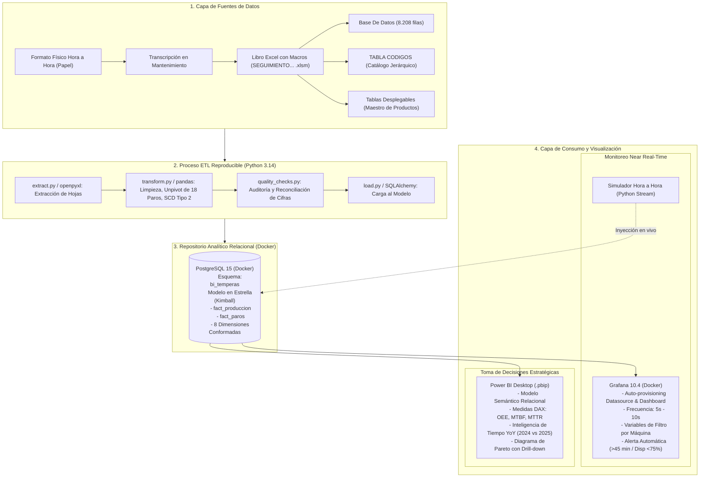
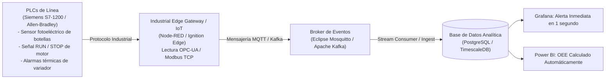

# Arquitectura de la Solución, Análisis Comparativo, Evolución IoT/SCADA y Gobernanza
**Proyecto de Inteligencia de Negocios End-to-End**

---

## 1. Diagrama de la Arquitectura Completa de la Solución

---

## 2. Análisis Comparativo: Grafana vs Power BI

| Criterio de Comparación | Grafana (Capa Operativa) | Power BI (Capa Estratégica) |
| :--- | :--- | :--- |
| **Audiencia y Usuarios Clave** | Supervisores de Línea, Operarias líderes, Técnicos de Mantenimiento de turno. | Alta Dirección, Gerente de Planta, Jefe de Mantenimiento, Líder de Calidad. |
| **Preguntas de Negocio que Resuelve** | • ¿Qué máquina está detenida en este instante y cuál es el motivo? • ¿Cuál es la disponibilidad del turno actual? • ¿Hay alguna alerta roja por paro mayor a 45 minutos? | • ¿Cómo se comportó la productividad interanual 2024 vs 2025? • ¿Cuál es el OEE consolidado del mes por referencia? • ¿Qué inversiones de CAPEX están justificadas por el Pareto de fallas? |
| **Frecuencia de Actualización** | **Segundos a minutos (Near Real-Time / Streaming continuo)** con auto-refresco en pantalla de planta (Andon). | **Horaria / Diaria / Mensual (Batch analítico)** para comités y análisis exploratorio profundo. |
| **Tipo de Visualizaciones** | Indicadores Gauge (tacómetros), semáforos de estado, gráficos de series temporales continuas y alertas activas. | Matrices con drill-down jerárquico, diagramas de Pareto 80/20 interactivos, inteligencia de tiempo DAX, filtrado cruzado bidireccional. |
| **¿Por qué NO son intercambiables?** | Grafana está diseñado para monitoreo de alta frecuencia y baja latencia de telemetría; no tiene un motor columnar para modelado semántico complejo ni inteligencia de tiempo multidimensional. | Power BI es el líder mundial en modelado semántico y reportes ejecutivos complejos; sin embargo, no está diseñado como pantalla de monitoreo operacional en vivo con refrescos de 5 segundos sin encarecer licenciamiento o sobrecargar el servicio. |

---

## 3. Propuesta de Evolución Futura: Captura Directa desde PLCs / SCADA

El esquema actual depende de un registro manual en papel de las operarias, lo que introduce retraso humano, sesgos y errores de transcripción. 

### 3.1 Arquitectura Propuesta para Industria 4.0
Para evolucionar la solución a captura automatizada directa de máquina:

### 3.2 Beneficios de la Integración SCADA:
1. **Detección Automática de Micro-paros:** Registro de paradas de 30 segundos que las operarias no alcanzan a anotar en el papel pero que erosionan el rendimiento.
2. **Eliminación de la Carga Administrativa:** El personal de mantenimiento y operarias dejan de transcribir planillas y se concentran en producción y mejora continua.
3. **Cálculo Exacto de Velocidad Real:** Lectura de pulsos de encoder para medir la velocidad de envasado milisegundo a milisegundo.

---

## 4. Gobernanza de Datos, Tratamiento de Datos Personales y Seguridad

### 4.1 Tratamiento de Datos Personales (Ley 1581 / GDPR)
En los registros se captura información de personas naturales:
* Nombres de operarias de línea (ej. *Diana, Lorena T., Yuliana*).
* Nombres completos de técnicos de mantenimiento (ej. *Carlos Arturo Arguello, Juan Diego Albarracin*).

**Políticas de Protección Implementadas:**
1. **Pseudonimización / Anonimización en Capa Analítica:**
   * En los reportes de Power BI destinados a comités generales o auditorías externas, los nombres se pueden mapear a códigos (`OP-014`, `TEC-MTO-03`) para evitar exposición innecesaria de datos personales y prevenir evaluaciones punitivas individuales.
2. **Finalidad Estrictamente Laboral y Operativa:**
   * La captura de datos de operarios se restringe exclusivamente al control técnico del proceso y no se transfiere a terceros.

### 4.2 Seguridad de Acceso a los Tableros (RBAC - Role-Based Access Control)
* **Grafana:**
  * Uso de roles nativos: `Viewer` para pantallas públicas de planta (modo Kiosko sin permisos de edición), `Editor` para supervisores de turno y `Admin` para ingeniería de datos.
* **Power BI:**
  * Implementación de **Row-Level Security (RLS)** para que cada supervisor visualice únicamente la línea o máquina asignada a su turno, mientras que la gerencia general tiene acceso no restringido a todas las plantas.
* **Gestión de Credenciales:**
  * Ninguna contraseña se almacena en el código ni en el repositorio Git. Todas las credenciales se gestionan estrictamente a través de variables de entorno (`.env` con `.env.example` versionado).
